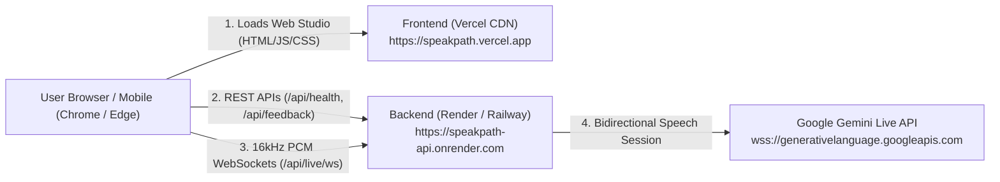

# SpeakPath AI — Complete Deployment Guide (Vercel + Render / Railway)

This guide walks you through deploying **SpeakPath AI** with a decoupled production architecture:
- **Frontend**: Hosted on **Vercel** (Global Edge CDN for React 19 + Tailwind CSS)
- **Backend & Voice Gateway**: Hosted on **Render** or **Railway** (Node.js runtime with persistent WebSocket support for real-time Gemini Live audio streaming)

---

## 🏗️ Architecture Overview



---

## 📋 Prerequisites

1. **GitHub Account**: [github.com](https://github.com)
2. **Vercel Account**: [vercel.com](https://vercel.com) (Free tier)
3. **Render Account**: [render.com](https://render.com) or **Railway Account**: [railway.app](https://railway.app) (Free tier)
4. **Google Gemini API Key**: [aistudio.google.com](https://aistudio.google.com/)

---

## Step 1: Push Code to Your GitHub Repository

Initialize and push your local SpeakPath AI project to your GitHub:

```bash
# 1. Add all source files (your .env and credentials are automatically ignored)
git add .

# 2. Create the initial commit
git commit -m "feat: complete SpeakPath AI with production deployment configs"

# 3. Create a new repository on GitHub (e.g. named 'speakpath-ai') and link it:
git remote add origin https://github.com/YOUR_GITHUB_USERNAME/speakpath-ai.git
git branch -M main
git push -u origin main
```

---

## Step 2: Deploy Backend on Render (WebSocket Voice Gateway)

Because Gemini Live voice streaming requires persistent WebSockets (`/api/live/ws`), the backend must run on a platform supporting WebSockets (like Render or Railway).

### Option A: Via Render Dashboard (Recommended)

1. Log in to [Render Dashboard](https://dashboard.render.com/).
2. Click **New +** > **Web Service**.
3. Select your GitHub repository (`speakpath-ai`).
4. Configure the service settings:
   - **Name**: `speakpath-api` (or your preferred name)
   - **Region**: Choose the closest region (e.g., `Oregon (US West)` or `Frankfurt (EU)`)
   - **Root Directory**: `server`
   - **Runtime**: `Node`
   - **Build Command**: `npm install && npm run build`
   - **Start Command**: `npm start`
   - **Plan**: `Free`
5. Scroll down to **Environment Variables** and add:
   - `NODE_ENV` = `production`
   - `GEMINI_API_KEY` = *Paste your Google Gemini API key from AI Studio*
   - `PORT` = `10000` *(Render sets this automatically, but 10000 is safe)*
6. Click **Create Web Service**.
7. Wait 1–2 minutes for the build to finish. Once live, copy your backend URL:
   - Example: `https://speakpath-api.onrender.com`

### Quick Health Verification
Open `https://speakpath-api.onrender.com/api/health` in your browser. You should see:
```json
{
  "ok": true,
  "status": {
    "geminiConfigured": true,
    "livekitConfigured": false,
    "port": 10000,
    "activeVoiceMode": "direct_gemini_live"
  }
}
```

---

## Step 3: Deploy Frontend on Vercel

1. Log in to [Vercel](https://vercel.com/dashboard).
2. Click **Add New...** > **Project**.
3. Import your GitHub repository (`speakpath-ai`).
4. In the **Configure Project** screen:
   - **Framework Preset**: `Vite`
   - **Root Directory**: Click *Edit* and select `client`
   - **Build Command**: `npm run build` (Default)
   - **Output Directory**: `dist` (Default)
5. Expand **Environment Variables** and add:
   - **Key**: `VITE_API_BASE_URL`
   - **Value**: `https://speakpath-api.onrender.com` *(Replace with your real Render backend URL from Step 2)*
6. Click **Deploy**.
7. In ~30 seconds, Vercel will give you your production URL:
   - Example: `https://speakpath-ai.vercel.app`

---

## Step 4: Verification & Smoke Test

1. **Visit your Vercel URL**: `https://speakpath-ai.vercel.app`
2. **Status Banner**:
   - The status bar at the top should say **"Gemini Live Connected (Ready to Practice)"**.
3. **Microphone Audio Test**:
   - Select any scenario (e.g. *Job Interview & HR Questions* or *Technical Interview*).
   - Click the central **Microphone** button and click **Allow** on the browser prompt.
   - Speak your answer: Coach Alex should respond verbally and the green soundwave visualizer will animate.
   - Turn-by-turn grammar feedback cards will appear in the right panel.
4. **Quick Phrase Translator**:
   - Click the **Translator** button in the header.
   - Type any phrase in Hindi, Telugu, Spanish, French, etc. Click **Translate to British English** and verify audio speech playback.

---

## 🛠️ Alternative: Deploy Backend on Railway

If you prefer [Railway](https://railway.app/):

1. Go to [railway.app/new](https://railway.app/new) and choose **Deploy from GitHub repo**.
2. Select `speakpath-ai`.
3. In the service **Settings**:
   - **Root Directory**: `/server`
   - **Build Command**: `npm install && npm run build`
   - **Start Command**: `npm start`
4. In **Variables**, add:
   - `GEMINI_API_KEY` = *your Gemini API key*
5. In **Networking**, click **Generate Domain**.
6. Copy the generated Railway domain (e.g., `https://speakpath-production.up.railway.app`) and set it as `VITE_API_BASE_URL` in your Vercel project settings!

---

## 🐳 Alternative: All-in-One Container (Docker)

If you wish to deploy SpeakPath AI as a single, all-in-one container on Google Cloud Run, AWS App Runner, or a VPS:

```bash
# Build Docker image
docker build -t speakpath-ai:latest .

# Run container locally or on any server
docker run -p 5000:5000 -e GEMINI_API_KEY="your_gemini_key_here" speakpath-ai:latest
```

The container bundles the Vite frontend into `server/dist`, automatically serving both the frontend web app and the live WebSocket API on a single port!
